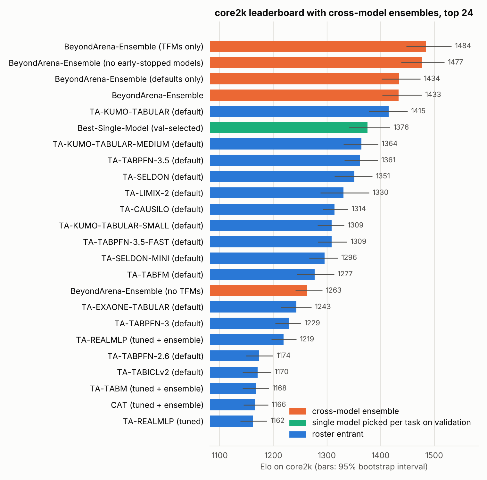
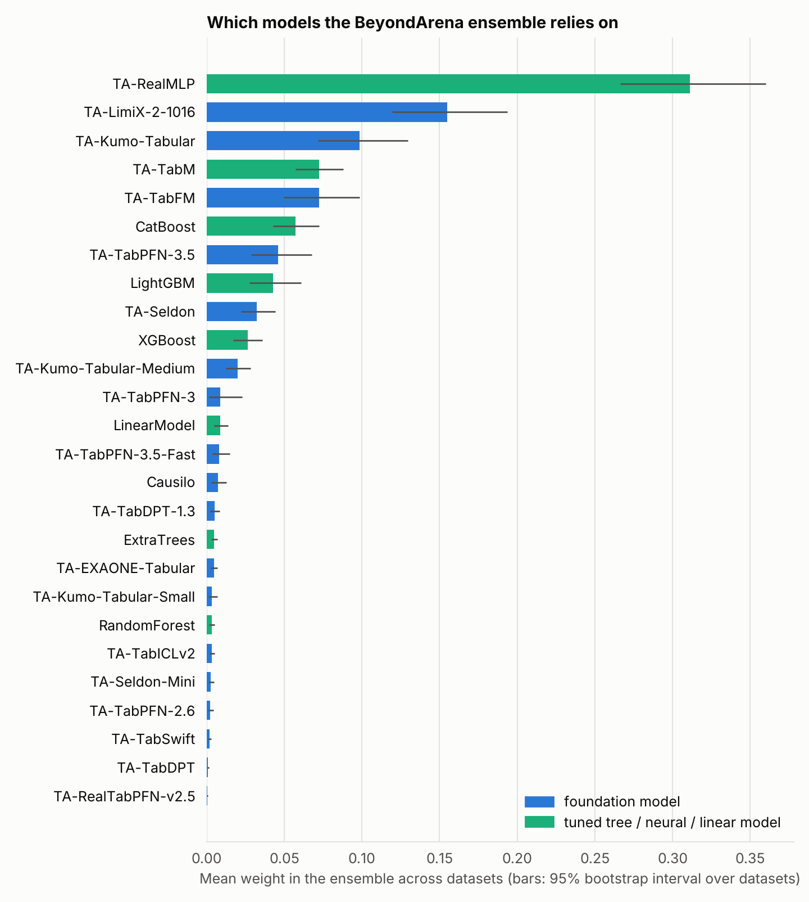
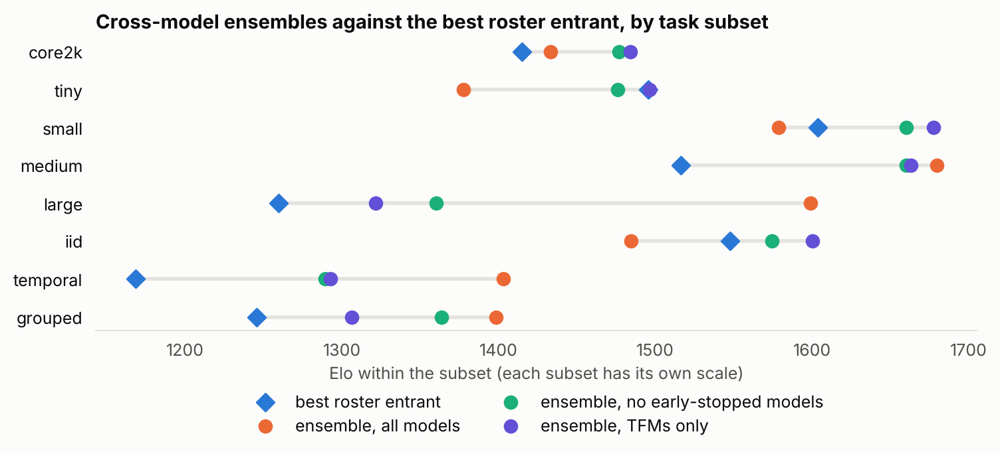
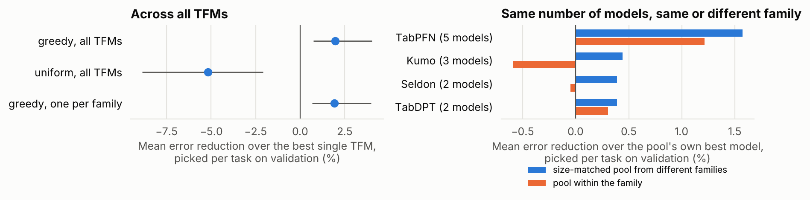
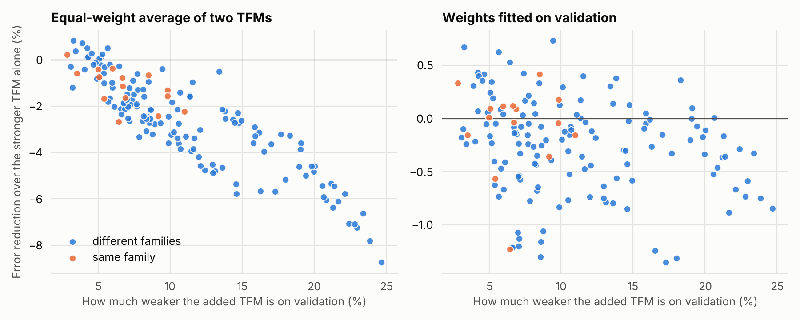

# A cross-model ensemble for BeyondArena

The TabArena paper builds a "TabArena ensemble" by post-hoc ensembling configurations of all its
models and shows that it beats every single model (Figure 7, Appendix C.4 and C.5). BeyondArena has
no such entrant. This folder builds one from the hosted BeyondArena predictions, without training
or predicting anything, and then uses the same predictions to ask whether ensembling across
different tabular foundation models (TFMs) is better than staying within one.

Everything below was run on the 26 methods of the BeyondArena roster on the `core2k` protocol
(2,000 splits of 142 datasets), on a 4-core machine without a GPU.

## Results in short

1. A cross-model ensemble beats every roster entrant, but which models go into the pool matters
   more than in TabArena. The pool of all 26 models reaches Elo 1433, next to 1415 for the best
   single model (Kumo-Tabular); paired per dataset the two are not distinguishable. The pool of the
   18 TFMs reaches 1484, and the pool without the five early-stopped models reaches 1477.
2. The reason is the one the TabArena paper reports for ModernNCA and RealMLP (Appendix A.6).
   Greedy ensemble selection trusts validation scores, and models that stop early on their
   validation fold have optimistic validation scores. RealMLP receives 31% of the ensemble weight
   on average, while its best entry ranks 13th among the roster entrants.
3. No pool wins everywhere. On large, temporal and grouped tasks the pool of all models is best by
   a wide margin; on tiny, small and IID tasks the TFM pool is best.
4. Ensembling across TFMs helps: weights fitted on validation over all 18 TFMs reduce the error of
   the best single TFM by 2.0% on average (95% interval 0.7% to 4.0%, better on 73% of datasets).
   An equal-weight average of all TFMs is worse than the best single one.
5. Whether two TFMs come from the same family or from different ones makes no measurable
   difference to the gain once the strength of the added model is accounted for. What decides the
   gain is how strong the added model is.

## What the TabArena paper does, and what is assumed here

The paper's recipe (Appendix C.4 and C.5):

- Post-hoc ensembling is greedy ensemble selection (GES, Caruana et al. 2004) with 40 steps. The
  weights are fitted on the validation predictions from inner cross-validation and applied to the
  test predictions.
- The TabArena ensemble pools a portfolio of 200 configurations across all models, learned with
  leave-one-dataset-out cross-validation, evaluates them in order until 4 hours are used, and runs
  GES over what was evaluated.

BeyondArena differs in ways that change the second step, so these assumptions were made:

| Choice | TabArena paper | Here | Why |
| --- | --- | --- | --- |
| Ensembler | GES, 40 steps, fitted on validation | the same, with TabArena's own `GreedyEnsembler` and metrics | identical |
| Pool | portfolio of 200 configs out of about 3,000 | one config per model: its tuned config (lowest validation error on the task); a TFM has one config | the roster has 18 TFMs with a single config and 8 tunable models with 25 to 200 configs, so there is little to learn a portfolio from; one config per model gives a fixed set of members with per-task weights, the choice made in the planning session |
| Time limit | 4 hours, portfolio order | none | the ensemble is simulated; its reported training time is the summed fit time of every config of every pooled model |
| Tasks | all splits | `core2k`, BeyondArena's default protocol | what the official leaderboard uses |
| Missing models | all models ran everywhere | per task, the pool is every model with predictions there | eight TFMs did not run tables above 100k training rows (38 of the 2,000 splits) |
| Metrics | AUC, log loss, RMSE | the same, read from the hosted results | identical |

Only validation predictions and validation labels are used to pick the tuned config and to fit the
weights. Test labels are used for scoring.

One thing could not be taken from the attached PDF: it contains the TabArena paper only, so the
BeyondArena protocol was read from this repository (`contexts/beyondarena/`).

## Reproduce

```bash
uv pip install --prerelease=allow -e "./packages/tabarena[plot]" stream-unzip scipy
```

```bash
python -P examples/beyondarena/advanced/post_hoc_ensemble/run_extract_predictions.py --root ~/beyond_slim
```

```bash
python -P examples/beyondarena/advanced/post_hoc_ensemble/run_build_ensemble.py --root ~/beyond_slim --output examples/beyondarena/advanced/post_hoc_ensemble/results
```

```bash
python -P examples/beyondarena/advanced/post_hoc_ensemble/run_tfm_ensembling_study.py --root ~/beyond_slim --output examples/beyondarena/advanced/post_hoc_ensemble/results/tfm_study
```

```bash
python -P examples/beyondarena/advanced/post_hoc_ensemble/run_make_figures.py --results examples/beyondarena/advanced/post_hoc_ensemble/results
```

On 4 cores the extraction took about 20 minutes (71 GB streamed, 4.4 GB kept), the ensemble 4
minutes and the TFM study 12 minutes. The tables in `results/` and the figures in `figures/` are
the output of these commands; the per-split tables are not committed.

## Step 1: get the predictions

The validation and test predictions of every config are hosted per method as `processed.zip`
(`https://data.tabarena.ai/cache/artifacts/<suite>/methods/<method>/processed.zip`), 71 GB zipped
for the roster. With enough disk, `BeyondArenaContext().load_repo(methods=...)` downloads them and
its `evaluate_ensembles_per` runs the same GES.

`slim_predictions.py` is the low-disk route. It streams each zip over HTTP, keeps per task only the
default and the tuned config, and never writes the zip to disk. The configs to keep are chosen from
the small hosted results tables before any prediction is read.

Three checks run on the way:

- Labels. The first method to reach a task writes its validation and test labels, every later
  method is compared against them, and the extraction stops on a difference. They agree on all
  2,000 tasks. The older artifacts stored regression targets as CSV text, which differs from the
  binary ones by float round-off (largest relative difference 3.5e-16), so floats are compared with
  a tolerance.
- Coverage. Every method has predictions for every task it has results for (`member_coverage.csv`).
  The extraction of a method fails, and is repeated on the next run, when a requested task is not
  in its artifact.
- Rescoring. Each kept config is rescored from the stored predictions and compared with the hosted
  error (`stored_prediction_check.csv`). For 19 of the 26 methods every task agrees within 0.1% on
  validation. The exceptions are small: TabPFN-3 differs on test by more than 0.1% on 3.8% of its
  tasks, RandomForest, ExtraTrees, RealMLP, TabM and Linear differ on 1% to 3.6% of theirs on
  validation or test, and four more methods on under 0.5%. On those tasks the stored arrays are
  not the exact ones the hosted error was computed from. The cause was not investigated. The
  simulator in this repository reads the same arrays, so it would see the same numbers.

## Step 2: build the ensemble

`run_build_ensemble.py` fits, per task, GES with 40 steps on the pool's validation predictions and
scores the weighted average on test. The ensembler, the metrics and the evaluator are TabArena's
(`tabarena.simulation`). Besides the pool of all models it fits five variants, defined before any
result was seen except where noted:

| Entrant | Pool |
| --- | --- |
| `BeyondArena-Ensemble` | tuned config of all 26 models: the analogue of the paper |
| `(defaults only)` | default config of all 26 models, so no tuning is needed |
| `(TFMs only)` | the 18 foundation models |
| `(no TFMs)` | the 8 tunable tree, neural and linear models |
| `(no early-stopped models)` | all models except CatBoost, LightGBM, XGBoost, RealMLP and TabM. Added after the first results, from a property known beforehand (see below) |
| `Best-Single-Model (val-selected)` | no ensemble: per task, the model with the lowest validation error |

The results are passed to `BeyondArenaContext.compare(new_results=...)`, so Elo, imputation and
bootstrap intervals are the leaderboard's own.

### Leaderboard



| Entrant | Elo | 95% interval | Improvability | Fit time per task | Predict time per task |
| --- | --- | --- | --- | --- | --- |
| BeyondArena-Ensemble (TFMs only) | 1484 | 1448 to 1532 | 6.0% | 3.1 h | 840 s |
| BeyondArena-Ensemble (no early-stopped models) | 1477 | 1438 to 1518 | 6.6% | 41 h | 829 s |
| BeyondArena-Ensemble (defaults only) | 1434 | 1401 to 1474 | 7.3% | 4.8 h | 684 s |
| BeyondArena-Ensemble | 1433 | 1403 to 1476 | 7.6% | 78 h | 609 s |
| Kumo-Tabular (best roster entrant) | 1415 | 1378 to 1450 | 8.1% | 0.2 h | 48 s |
| Best-Single-Model (val-selected) | 1376 | 1341 to 1417 | 8.2% | 78 h | 167 s |
| BeyondArena-Ensemble (no TFMs) | 1263 | 1241 to 1291 | 14.4% | 75 h | 48 s |
| RealMLP (tuned + ensemble), best non-TFM | 1219 | 1197 to 1243 | 15.8% | 13 h | 122 s |

Times are means over tasks. The fit time of an ensemble is the summed fit time of every config of
every pooled model, the predict time that of the members with non-zero weight (3.6 of 25.9 members
on average for the pool of all models). Full tables: `results/leaderboard_core2k_variants.csv` and
one file per subset. Elo depends on the set of entrants: with the pool of all models as the only
added entrant (`results/leaderboard_core2k.csv`) it scores 1431 next to 1426 for Kumo-Tabular.

Elo intervals of the top five overlap, so `ensemble_vs_best_roster_model_paired.csv` compares each
ensemble with Kumo-Tabular per dataset (errors averaged over splits, 142 datasets, Wilcoxon
signed-rank, Holm-adjusted):

| Ensemble | Mean error reduction | 95% interval | Datasets improved | p (Holm) |
| --- | --- | --- | --- | --- |
| TFMs only | 2.6% | 1.1% to 4.5% | 69% | < 0.001 |
| no early-stopped models | 0.9% | -1.0% to 2.5% | 66% | < 0.001 |
| defaults only | -0.3% | -2.4% to 1.5% | 56% | 1.0 |
| all models | -0.6% | -2.8% to 1.5% | 52% | 1.0 |
| no TFMs | -9.5% | -13.6% to -5.9% | 22% | < 0.001 |

So the direct analogue of the TabArena ensemble ranks first among the entrants it is compared with,
but it does not beat the best single model by a margin that holds up per dataset. The TFM pool does.

### Why the pool of all models is not the best one



RealMLP gets 31% of the weight averaged over datasets (95% interval 27% to 36%), more than any TFM,
and the five early-stopped models together get about half. The TabArena paper saw the same pattern
and traced it to validation overfitting. `validation_optimism.csv` measures it here as
(test error - validation error) / test error, median over datasets:

| Model | Tuned config | Default config |
| --- | --- | --- |
| RealMLP | +2.7% | -1.5% |
| TabM | +0.5% | -0.7% |
| CatBoost, LightGBM | 0.0% | -1.1%, -1.2% |
| XGBoost | -0.3% | -2.2% |
| Linear | -0.7% | -2.8% |
| RandomForest, ExtraTrees | -2.9%, -2.5% | -3.4%, -3.1% |
| the 18 TFMs | -2.7% to -3.6% | the same |

A model whose validation predictions come from honest out-of-fold fits should look slightly worse
on validation than on test, because the fold models saw less data: about -3%, where the TFMs and
the forests sit. Gradient-boosted trees, RealMLP and TabM stop early on the fold that also yields
their validation predictions, and choosing the best of many configs on validation adds to it. Their
validation errors are 2 to 6 points too good compared with a TFM, and GES shifts weight to them.
Tuning is the smaller part of the effect: the pool of default configs scores the same as the pool
of tuned ones (1434 and 1433).

The `(no early-stopped models)` pool removes those five models by that property, without looking at
test results, and recovers most of the gap (1477). The paper leaves an overfitting-aware selection
method as future work; the same applies here, and this pool is the simplest version of it.

### By task subset



| Subset | Best roster entrant | its Elo | All models | No early-stopped | TFMs only |
| --- | --- | --- | --- | --- | --- |
| core2k | Kumo-Tabular | 1415 | 1433 | 1477 | 1484 |
| tiny | Kumo-Tabular | 1495 | 1377 | 1476 | 1496 |
| small | LimiX-2 | 1604 | 1579 | 1660 | 1678 |
| medium | Kumo-Tabular | 1516 | 1680 | 1660 | 1663 |
| large | RealMLP (tuned + ensemble) | 1260 | 1599 | 1360 | 1321 |
| IID | Kumo-Tabular | 1548 | 1484 | 1574 | 1600 |
| temporal | Kumo-Tabular | 1168 | 1403 | 1290 | 1293 |
| grouped | RealMLP (tuned + ensemble) | 1246 | 1398 | 1364 | 1306 |

Elo is computed within each subset, so compare along rows only.

The pool of all models is best where the BeyondArena paper finds TFMs weakest: large tables,
temporal and grouped splits. There the tuned trees and neural networks carry real signal and the
ensemble gains 150 to 340 Elo on the best entrant. On tiny tables it loses to the best single TFM,
where validation sets are small and overfitting them is easy. The pool without early-stopped models
is never the best, and is the only one that is at or above the best roster entrant in seven of
eight subsets and within 20 Elo in the eighth (tiny).

Which pool to call "the" BeyondArena ensemble depends on the goal. For a faithful counterpart of
the TabArena ensemble, it is the pool of all models. For the strongest entrant on `core2k` chosen
by a rule that does not use test results, it is the pool without early-stopped models. The TFM
pool scores highest overall, but it was one of several variants compared on test results, so its
lead over the others is partly a selection effect.

## Step 3: across TFMs, or within one?

### What the stored predictions can and cannot answer

Most TFMs ensemble internally: several forward passes over permuted features, preprocessing recipes
or sampled contexts, averaged. The hosted prediction of a TFM is the output after that averaging.
The per-member predictions are not stored, so the direct comparison (model A with 2K internal
members against A and B with K members each) cannot be simulated. No roster entry differs from
another only in its number of members either: TabPFN-3.5-Fast, Kumo-Tabular-Small and Seldon-Mini
are smaller checkpoints, not smaller ensembles.

What can be tested without compute:

1. Does a post-hoc ensemble across TFMs improve on a single TFM that already ensembles internally?
2. Is the gain smaller when the added TFM is from the same family, meaning a checkpoint of the same
   lineage (TabPFN: 2.6, Real-2.5, 3, 3.5, 3.5-Fast; Kumo: three sizes; Seldon: two; TabDPT: two)?
3. Is one large checkpoint better than the average of two small ones from different families?

### Design

- Tasks: the 1,962 `core2k` splits on 120 datasets where all 18 TFMs have predictions (tables up to
  100k training rows). Every arm sees the same tasks and nothing is imputed.
- Unit of analysis: the dataset. Errors are averaged over a dataset's splits first, so the 2 to 25
  splits of one dataset do not count as independent observations.
- Outcome: relative error reduction per dataset, clipped to [-100%, 100%] so that near-zero errors
  cannot dominate a mean. Reported with a bootstrap interval over datasets, the share of datasets
  improved and a Wilcoxon signed-rank test, Holm-adjusted within each table.
- No test information in any choice. Weights are fitted on validation or not fitted at all
  (equal-weight averages). Where a "best" model is needed, it is the one with the lower validation
  error on that task, or the best mean validation rank over all tasks.
- Single-model errors are rescored from the same stored predictions the ensembles use.

### Question 1: across TFMs against a single TFM

Baseline: the best single TFM picked per task on validation.

| Ensemble | Mean error reduction | 95% interval | Datasets improved | p (Holm) |
| --- | --- | --- | --- | --- |
| GES over all 18 TFMs | 2.0% | 0.7% to 4.0% | 73% | < 0.001 |
| GES over one TFM per family (10 models) | 1.9% | 0.7% to 4.0% | 83% | < 0.001 |
| equal-weight average of all 18 | -5.2% | -8.9% to -2.1% | 32% | < 0.001 |

Against Kumo-Tabular on every task the numbers are 2.4%, 2.3% and -4.4%. Ensembling across TFMs
helps, and it needs fitted weights: the TFMs differ too much in strength for a plain average.
Keeping one model per family loses nothing, which already suggests that siblings add little.



### Question 2: same family against different families

Two views, both controlling for the strength of the pooled models.

Pools of equal size. For each family, GES over its members is compared with GES over the same
number of models from different families (the best-validating one per family). A pool of stronger
models has lower error whatever its diversity, so the comparison is the gain of each ensemble over
the best single model of its own pool, picked per task on validation:

| Family (models) | Gain within the family | Gain across families | Difference | 95% interval | p (Holm) |
| --- | --- | --- | --- | --- | --- |
| TabPFN (5) | 1.2% | 1.6% | 0.4 | -0.2 to 1.1 | 0.66 |
| Kumo (3) | -0.6% | 0.4% | 1.0 | 0.0 to 2.9 | 0.049 |
| Seldon (2) | 0.0% | 0.4% | 0.4 | -0.1 to 1.2 | 0.66 |
| TabDPT (2) | 0.3% | 0.4% | 0.1 | -0.2 to 0.5 | 0.71 |

The difference points the same way in all four families and is small. Only Kumo reaches
significance, barely.

All 153 pairs. For each pair of TFMs the gain is measured over the pair's stronger member, picked
per split by its validation error, for the equal-weight average and for fitted weights. A regression of
the pair's mean gain on how much weaker the added model is (on validation) and on whether the pair
is from different families gives the family effect at equal strength. Intervals come from
resampling datasets, which keeps the dependence between pairs that share a model.

| Ensembler | Family effect at equal partner strength | 95% interval | p |
| --- | --- | --- | --- |
| equal-weight average | -0.02 points | -0.46 to 0.38 | 0.91 |
| weights fitted on validation | +0.05 points | -0.06 to 0.17 | 0.31 |



No family effect is detectable in the pairs. What drives the gain of an equal-weight pair is the
partner's strength: every 10 points of validation gap cost about 3 points of error. Residuals of
same-family pairs are slightly more correlated (0.965 against 0.947), in line with a small
diversity advantage of different families, but all TFMs make very similar errors.

A second finding of this view: a second TFM helps a little when its weight is fitted, and hurts
when it is not. With fitted weights 88% of the pairs beat their stronger member on average, by 0.4%
(different families) and 0.5% (same family). Of the equal-weight pairs 18% do. The 2% of question 1
needs GES over many candidates.

### Question 3: one large checkpoint or two small ones from different families

| Average of | Against | Predict-time ratio | Mean error reduction | 95% interval | p (Holm) |
| --- | --- | --- | --- | --- | --- |
| TabPFN-3.5-Fast + Kumo-Small | TabPFN-3.5 | 0.6 | 1.1% | -0.6% to 3.0% | 0.99 |
| TabPFN-3.5-Fast + Seldon-Mini | TabPFN-3.5 | 0.5 | 1.0% | -0.4% to 2.6% | 0.99 |
| TabPFN-3.5-Fast + Kumo-Small | Kumo-Tabular | 1.0 | -5.8% | -9.5% to -2.7% | < 0.001 |
| Kumo-Small + Seldon-Mini | Kumo-Tabular | 0.5 | -5.5% | -8.8% to -2.8% | < 0.001 |
| TabPFN-3.5-Fast + Seldon-Mini | Seldon | 1.7 | -3.2% | -6.0% to -0.9% | 0.004 |
| Kumo-Small + Seldon-Mini | Seldon | 1.1 | -3.3% | -6.2% to -0.9% | 0.001 |

For Kumo and Seldon the large checkpoint beats the average of two small models from different
families at similar or higher inference cost. For TabPFN-3.5 the two-model average matches it at
about half the inference time.

### Answer and limits

With the stored predictions, the answer is: ensemble across TFMs, with fitted weights, and expect a
modest gain (about 2% error, about 70 Elo on `core2k`). Whether the pooled models share a family
matters much less than how strong they are. A TFM's built-in ensembling and a post-hoc ensemble
across TFMs are complements, not alternatives, in this data: the cross-TFM gain is measured on top
of every model's internal ensemble.

Limits:

- The within-TFM arm is a proxy. Sibling checkpoints are not the same as more internal members of
  one checkpoint, which would be even less diverse.
- Family is confounded with strength (Kumo's members are all strong, TabDPT's are weak). The
  analyses adjust for strength on validation, with a linear term in the pair view.
- Four families and 15 same-family pairs give little power for a small effect. The intervals of
  the pair view exclude a family effect larger than about half a point of error.
- Tasks above 100k training rows are excluded, since eight TFMs did not run them.

### A follow-up that settles the within-TFM question with little compute

The missing piece is the per-member predictions. A targeted rerun would provide them:

1. Take four or five TFMs with a member count in their wrapper (TabPFN-3.5, TabICLv2, LimiX-2,
   Causilo: `n_estimators`; EXAONE-Tabular: `ensemble_count`).
2. Rerun them on split 0 of the datasets up to 10k training rows, saving the validation and test
   prediction of each internal member instead of only their average. This is inference only for
   most TFMs, on roughly 80 small tasks per model.
3. Simulate, from those stored members, every mix at equal budget: K members of A against K/2 of A
   plus K/2 of B, for K in 2, 4, 8, 16, with the paired per-dataset tests used above.

Because members are stored once, all budgets and all model pairs can be simulated afterwards
without further compute, the way this folder reuses the hosted predictions. Storing per-member
predictions in future BeyondArena runs would make the comparison free.

## Files

| File | Purpose |
| --- | --- |
| `slim_predictions.py` | stream a method's `processed.zip`, keep the default and tuned config per task; `SlimStore` reader |
| `ensembling.py` | fit and score one ensemble on one task with TabArena's ensemblers and metrics |
| `run_extract_predictions.py` | step 1 |
| `run_build_ensemble.py` | step 2: ensembles, checks, leaderboards |
| `run_tfm_ensembling_study.py` | step 3 |
| `run_make_figures.py` | figures |
| `tabpfn_api_model.py`, `run_tabpfn_members.py`, `run_within_vs_across_tfm.py` | step 5, pending: the equal-budget follow-up through the hosted TabPFN API (see below) |
| `results/`, `figures/` | committed outputs |

## Pending: the equal-budget follow-up

This step answers whether ensembling within a TFM or across TFMs is better at equal compute, which
the stored predictions cannot (they hold each TFM's internal ensemble only after averaging). It
uses the hosted Prior Labs API, whose TabPFN-3.5 takes the ensemble size as `n_estimators`.

- `tabpfn_api_model.py`: TabPFN-3.5 through the API as a TabArena model. Run inside the pipeline,
  it reproduces the stored predictions: the labels match exactly, and the test predictions differ
  by at most 0.0006 on blood_transfusion and 0.04 on 9 more datasets. `TabPFN35CaptureModel`
  records the final model's preprocessed tables instead of calling the API.
- `run_tabpfn_members.py`: `capture` stores those tables for split 0 of the 84 tiny and small
  datasets without text columns (no API calls), `estimate` prices the planned calls with the API's
  free estimate, `run` requests the test predictions of TabPFN-3.5 at 1, 2, 4 and 16 members
  (8 members are stored; they are also requested on 10 datasets as a check).
- `run_within_vs_across_tfm.py`: the error against ensemble size, and 16 members against 8 members
  plus a TFM of another family, all equal-weight averages, paired per dataset. The partner's predict time relative to 8 TabPFN-3.5 members is reported per row.

Cost: a predict call costs 10,000 tokens up to 16 members (about 22,000 at 32) and a key gets 5M
tokens a month, so the design makes one call per dataset and size: 346 calls, 3.6M tokens by the
API's estimate. A first attempt that ran every inner fold
(about 27,000 calls) used up the November quota; the run is scheduled for December 1, when the
quota resets. Results will be added here.

Equal-weight averages only: this design requests no validation predictions, so weights fitted on
validation are not part of it.

## Not done

- The paper's portfolio variant (many configs per model, learned leave-one-dataset-out) needs all
  configs of the tunable models, about 60 GB more than the slim store keeps.
- The per-model `(tuned + ensemble)` entrants are not pool members, for the same reason.
- The ensemble is not registered as a leaderboard method and nothing was uploaded.
- Six roster methods are marked unverified in `contexts/beyondarena/methods.py` (Causilo, TabFM,
  EXAONE-Tabular, RealTabPFN-2.5, TabDPT-1.3, TabSwift). They are in the pools as roster members.
